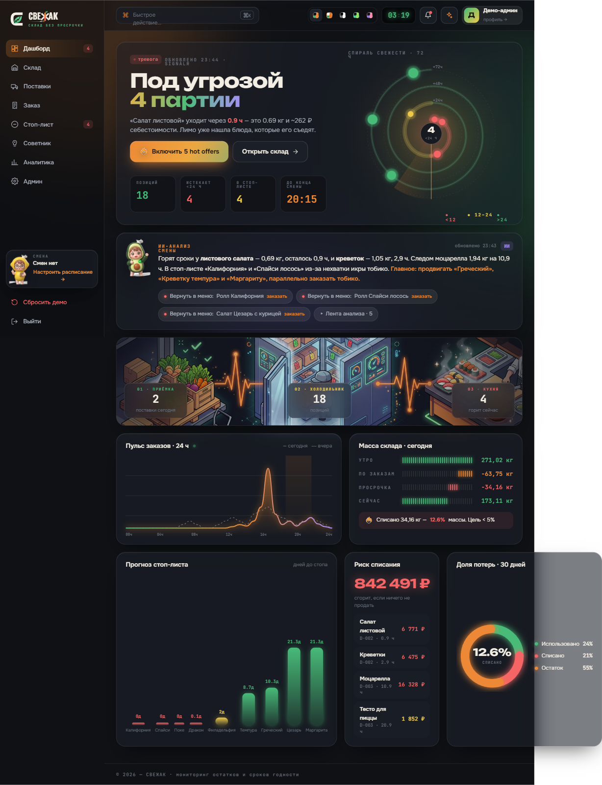
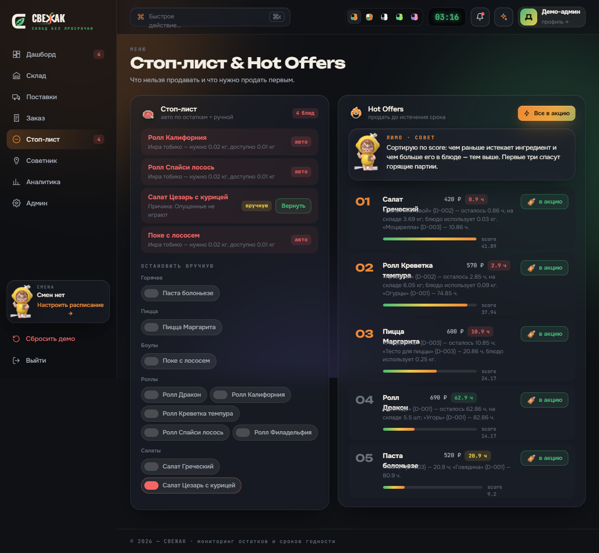
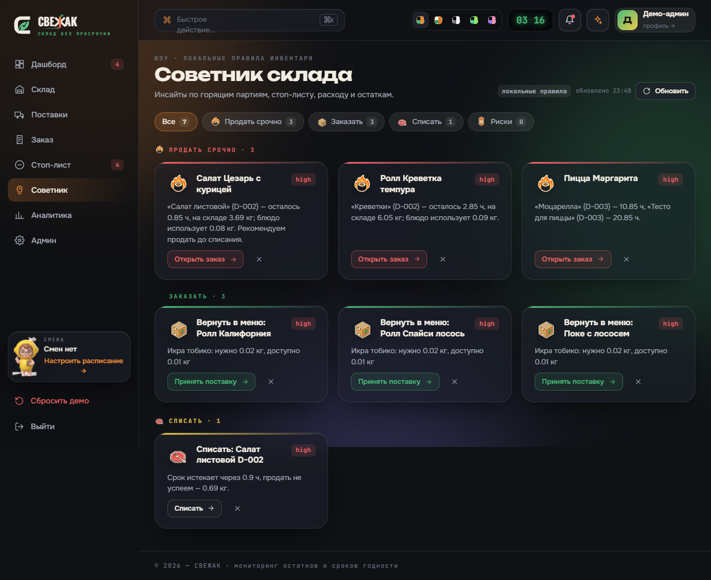
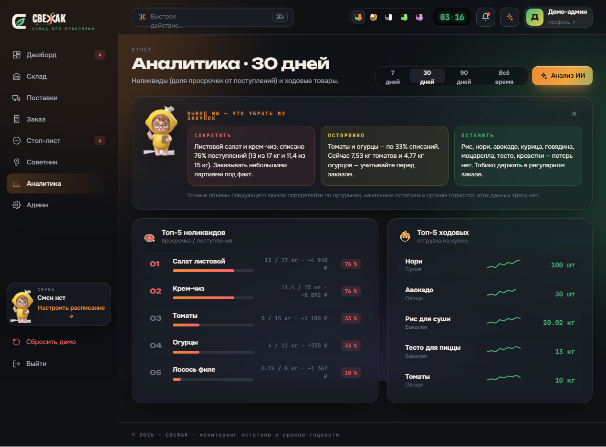
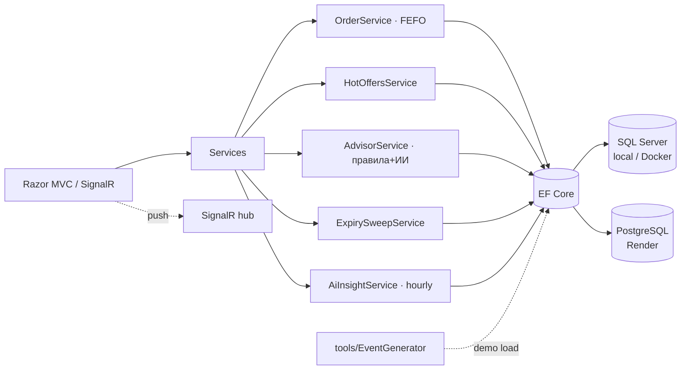

# 🥑 СВЕЖАК

### Склад без просрочки — шеф и ИИ следят за кухней вместе


---

## Что это

**СВЕЖАК** — система мониторинга склада ресторана. Партии приходят со сроком годности в часах, кухня списывает их по **FEFO** (первой уходит самая ранняя), а система следит, чтобы ничего не сгорело. Перестаёт хватать ингредиента — блюдо само падает в стоп-лист, горит партия — поднимаются **hot offers** (что продать срочно), а **ИИ-советник** каждую смену подсказывает: что списать, что заказать, что убрать из закупок.

Один экран — один смысл: дашборд тревог, склад с LED-сроком по каждой партии, приёмка за 30 секунд, стоп-лист и аналитика потерь.

## Интерфейс

| Дашборд · Спираль свежести | Стоп-лист & Hot Offers |
|:---:|:---:|
|  |  |
| **ИИ-советник** | **Аналитика потерь** |
|  |  |

*5 тем (night / paper / mono / matcha / lilac) — переключаются свотчем в шапке.*

## Демо-доступ

| Роль | Код | Что видит |
|---|---|---|
| 👨‍🍳 Менеджер ресторана | `MANAGER1234` | полный склад: партии, приёмка, заказ, стоп-лист, советник, аналитика |
| 🛠 Админ | `ADMIN1234` | смены, сотрудники, рестораны, продукты, импорт |
| 🏢 Владелец сети | `OWNER1234` | все точки сети, персонал по ресторанам, аналитика сети |
| 🏛 Платформа | `HQ000001` | заявки от сетей (`/Platform/Leads`) |

**Живое демо:** 
- 🌐 https://umirhack.tech | 🚀 https://app.umirhack.tech — лендинг


## Быстрый старт

**Нужно:** [.NET 10 SDK](https://dotnet.microsoft.com/), Docker (для SQL Server).

```bash
# 1) поднять БД (SQL Server в контейнере)
docker compose up -d

# 2) строка подключения в user-secrets
dotnet user-secrets set "ConnectionStrings:Default" "Server=localhost,1433;Database=Svezhak;User Id=sa;Password=Your_password123;TrustServerCertificate=True"

# 3) миграции + сид демо-данных
dotnet ef database update

# 4) запуск
dotnet run
# → http://localhost:5201, вход MANAGER1234
```

На проде (Render) та же сборка работает на **PostgreSQL** — провайдер переключается конфигом, схема патчится идемпотентно на старте.

## ИИ-функции

ИИ гоняется через OpenAI-совместимый endpoint (советник, чат склада, вывод аналитики, ежечасный инсайт смены). Включается ключом:

```bash
dotnet user-secrets set "Ai:BaseUrl" "<url провайдера>"
dotnet user-secrets set "Ai:Model"   "<модель>"
dotnet user-secrets set "Ai:ApiKey"  "<ключ>"
```

> ⚠️ **Ключ нигде не хранится в репо.** Без него всё работает на локальных правилах (fallback): инсайты, hot offers, дедупликация рекомендаций — ничего не падает.

## Архитектура



Слои: контроллеры тонкие, вся бизнес-логика в `Services/` (FEFO-списание, дефицит, стоп-лист, скоринг офферов, агрегация потерь). Realtime — через `_InventoryRealtime` шину: изменение склада мягко подтягивает виджеты без перезагрузки.

## Тесты

```bash
dotnet test
```

`Svezhak.Tests` покрывает ядро: **FEFO-порядок** списаний, дефицит и отказ заказа, просрочку партий, защиту от ухода в минус, авто-стоп-лист, генерацию hot offers.

## Команда

**SSS** — Ан Марк · Литвинов Ренат · Мисюрин Андрей
Хакатон **UMIRHack3**, кейс «Флагман», октябрь 2026.
